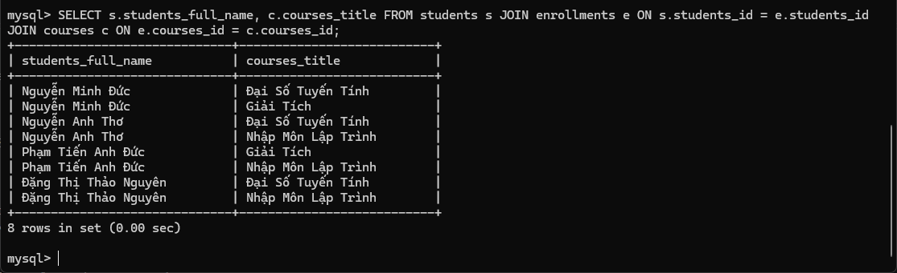
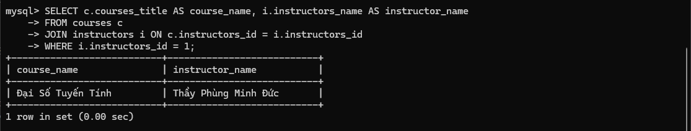
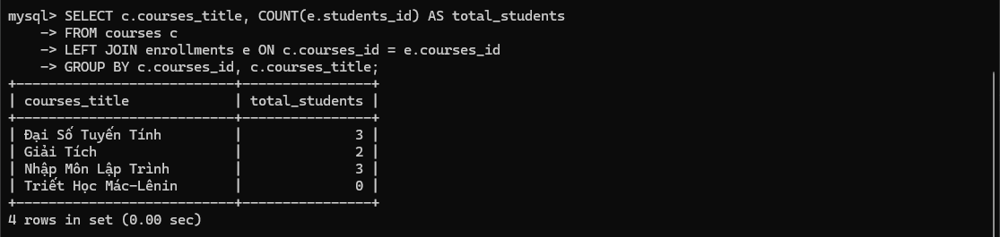
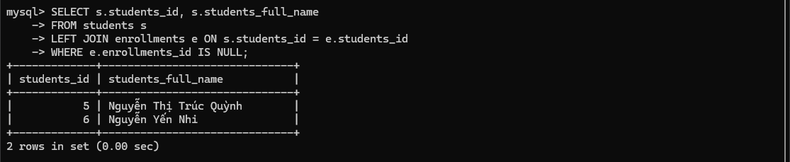

# Student Courses Database

Dự án này mô tả một cơ sở dữ liệu quản lý sinh viên, giảng viên, môn học và đăng ký học phần. Mục tiêu chính là lưu trữ thông tin về các môn học, người dạy và danh sách sinh viên đăng ký từng môn.

Database gồm 4 bảng chính:
- instructors: lưu thông tin giảng viên
- students: lưu thông tin sinh viên
- courses: lưu thông tin các môn học
- enrollments: lưu thông tin sinh viên đăng ký môn học

- Mỗi giảng viên có instructors_id, instructors_nam, instructors_email
- Mỗi sinh viên có students_id, students_full_name, students_birth_date
- Mỗi môn học có courses_id, courses_title, instructors_id
- Mỗi đăng ký học phần có enrollments_id, students_id, courses_id

Quan hệ:
- Một giảng viên có thể dạy nhiều môn học
- Một sinh viên có thể đăng ký nhiều môn học
- Một môn học có thể có nhiều sinh viên đăng ký

##  Cách chạy SQL

1. Mở MySQL
2. Chạy file database.sql;
3. Chạy file truy vấn mẫu SOURCE queries.sql;

### Query Result 
Query 01 - Student Course List

Query 02 - Instructor Courses

Query 03 - Enrollment Count

Query 04 - Students Without Enrollments

