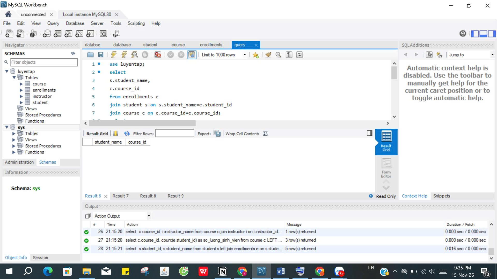
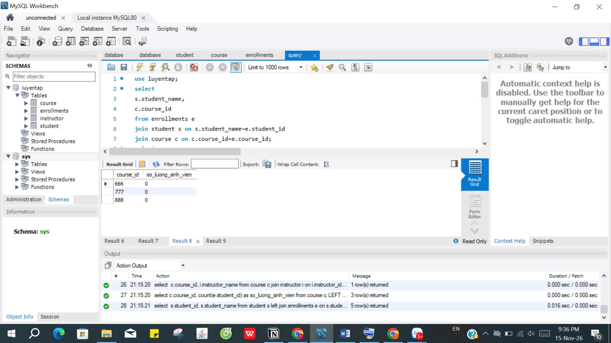
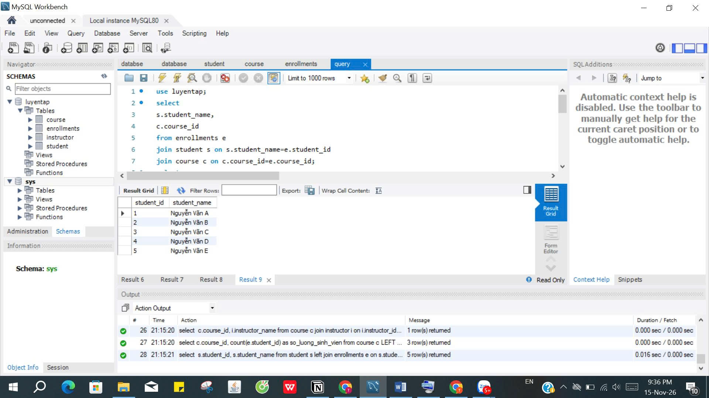

Markdown
# Week 01 - Database Design & SQL Queries

## Thông tin sinh viên
- **Họ và tên:** Hồ Viết Trọng
- **MSSV:** 26522133
- **GitHub:** koro1603

## Mô tả Database
Database `luyentap` quản lý thông tin đăng ký môn học của sinh viên gồm 4 bảng:
- `student`: Lưu thông tin sinh viên (`student_id` là khóa chính).
- `instructor`: Lưu thông tin giảng viên (`instructor_id` là khóa chính).
- `course`: Lưu thông tin môn học (`course_id` là khóa chính, `instructor_id` là khóa ngoại tham chiếu đến `instructor`).
- `enrollments`: Bảng trung gian lưu lượt đăng ký môn học của sinh viên (`enrollment_id` là khóa chính, `student_id` và `course_id` là khóa ngoại, có ràng buộc `UNIQUE` ngăn sinh viên đăng ký trùng một môn).

## Cách chạy SQL
1. Mở MySQL Workbench và kết nối vào Local instance.
2. Mở file `database.sql` và chạy toàn bộ để tạo database, cấu trúc các bảng và thêm dữ liệu mẫu.
3. Mở file `queries.sql` và chạy từng câu truy vấn để kiểm tra kết quả.

## Query Results

### Query 1: Liệt kê tên sinh viên và tên các môn đã đăng ký

### Query 2: Liệt kê các môn do một giảng viên cụ thể phụ trách

### Query 3: Đếm số sinh viên đăng ký từng môn, kể cả môn chưa có người đăng ký

### Query 4: Tìm sinh viên chưa đăng ký bất kỳ môn nào

