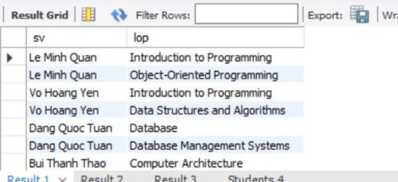
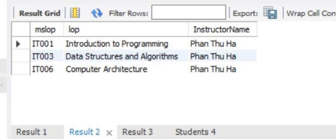
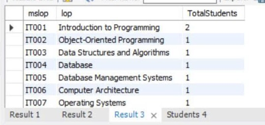
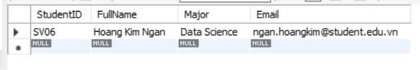

# GDGoC-UIT | Software Study Group
**Week 01 – Software fundamentals & Database design**

## 1. Thông tin người 
- **Họ tên:** Lê Thị Thanh Hảo

## 2. Mô tả Database
### Cơ sở dữ liệu gồm 4 bảng:
- **STUDENTS:** Lưu thông tin sinh viên gồm: Mã sinh viên (StudentID), Họ tên (FullName), Ngành (Major), Email
- **INSTRUCTORS:** Lưu thông tin giảng viên gồm: Mã giảng viên (InstructorID), Họ tên (FullName), Email
- **COURSES:** Lưu thông tin môn học gồm: Mã môn học (CourseID), Tên môn học (CourseName), Số tín chỉ (Credits), Mã giảng viên dạy (InstructorID)
- **ENROLLMENTS:** Lưu thông tin đăng ký môn học của sinh viên gồm: Mã khóa học (CourseID), Mã sinh viên (StudentID), Ngày đăng ký (EnrollmentDate)

### Mối quan hệ giữa các bảng:
- Một môn học do một giảng viên dạy nhưng một giảng viên có thể dạy nhiều môn (1:N).
- Một sinh viên có thể đăng ký nhiều môn học và một môn học có thể có nhiều sinh viên đăng ký (N:N thông qua bảng `Enrollments`).

## 3. Cách chạy SQL
1. Mở **MySQL Workbench**, kết nối với Server và tạo tab SQL mới.
2. Chạy file script khởi tạo database `QLSV`, tạo bảng và thêm dữ liệu mẫu.
3. Chạy lần lượt 4 câu lệnh truy vấn từ file "queries.sql" và kiểm tra kết quả.

## 4. Query Results
1. Query 01: Liệt kê tên sinh viên và tên các môn đã đăng ký.

2. Query 02: Liệt kê các môn do 'GV02' cụ thể phụ trách.

3. Query 03: Đếm số sinh viên đăng ký từng môn, kể cả môn chưa có người đăng ký.

4. Query 04: Tìm sinh viên chưa đăng ký bất kỳ môn nào.
