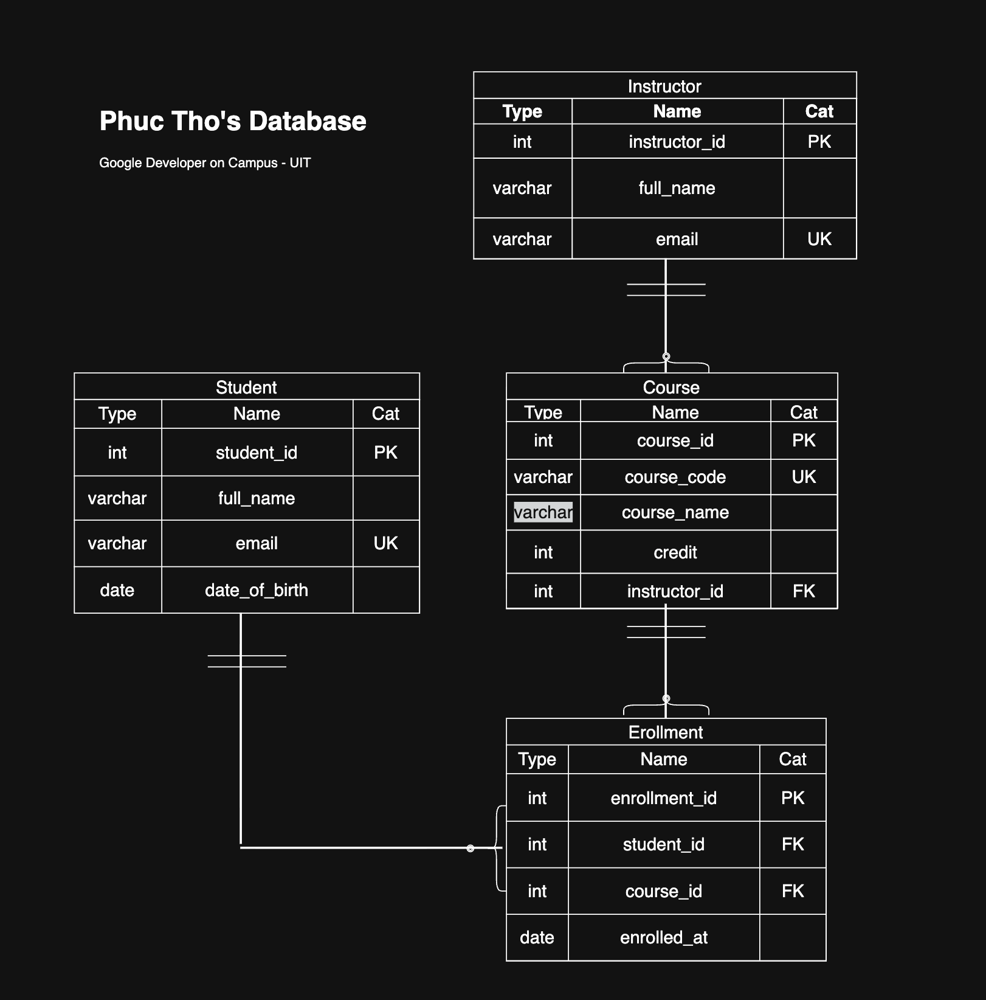
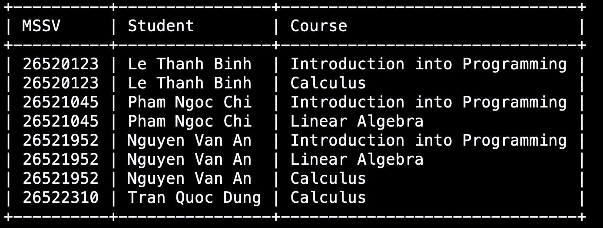
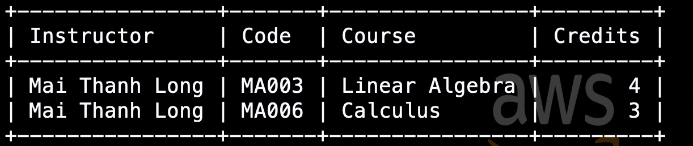
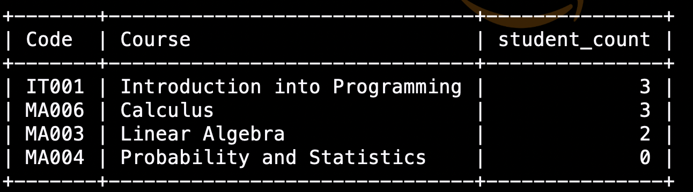
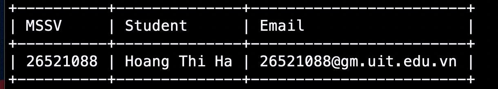

# Week 01 - Student Course Management Database

GDGoC-UIT | Software Study Group | Week 01: Software fundamentals & database design

## Thông tin người nộp

| | |
|---|---|
| Họ tên | `Nguyễn Duy Phúc Thọ` |
| Lớp | `KHMT` |
| DBMS | MySQL 8.4 (chạy bằng Docker) |

## Cấu trúc thư mục

```
.
├── README.md
├── database.sql      # Tạo database, tạo bảng, chèn dữ liệu mẫu
├── queries.sql       # 4 truy vấn theo yêu cầu
├── erd.png           # Sơ đồ ERD
└── screenshots/      # Ảnh kết quả 4 truy vấn
```

## Mô tả database

Database `student_course_db` quản lý sinh viên, giảng viên, môn học và việc đăng ký môn học. Gồm 4 bảng:

| Bảng | Mô tả | Khoá chính | Khoá ngoại |
|---|---|---|---|
| `Instructors` | Giảng viên | `instructor_id` | |
| `Students` | Sinh viên | `student_id` (MSSV) | |
| `Courses` | Môn học | `course_id` | `instructor_id` → `Instructors` |
| `Enrollments` | Lượt đăng ký môn | `enrollment_id` | `student_id` → `Students`, `course_id` → `Courses` |

**Quan hệ giữa các bảng:**

- **Instructors - Courses (1-N):** một giảng viên phụ trách nhiều môn, mỗi môn chỉ có một giảng viên. Khoá ngoại nằm ở phía "nhiều", tức bảng `Courses`.
- **Students - Courses (N-N):** một sinh viên học nhiều môn, một môn có nhiều sinh viên. SQL không biểu diễn trực tiếp được quan hệ N-N, nên tách thành hai quan hệ 1-N đi qua bảng trung gian `Enrollments`.



**Dữ liệu mẫu:** 4 giảng viên, 5 sinh viên, 4 môn học, 8 lượt đăng ký.


## Query Results

### Query 01: Tên sinh viên và các môn đã đăng ký

Dùng `INNER JOIN` hai lần qua bảng trung gian `Enrollments`. Kết quả: 8 dòng.



### Query 02: Các môn do một giảng viên phụ trách

Ví dụ với giảng viên `Mai Thanh Long`. Kết quả: MA003, MA006.



### Query 03: Số sinh viên đăng ký từng môn, kể cả môn chưa có ai đăng ký

Dùng `LEFT JOIN` từ `Courses` và `COUNT(e.student_id)` thay cho `COUNT(*)`, để môn chưa có ai đăng ký vẫn hiện ra với số lượng 0 (`COUNT(*)` sẽ đếm cả dòng NULL và trả về 1). Kết quả: MA004 có `student_count = 0`.



### Query 04: Sinh viên chưa đăng ký môn nào

Dùng kỹ thuật anti-join: `LEFT JOIN` rồi lọc `WHERE e.enrollment_id IS NULL`. Kết quả: 26521088 - Hoang Thi Ha.




