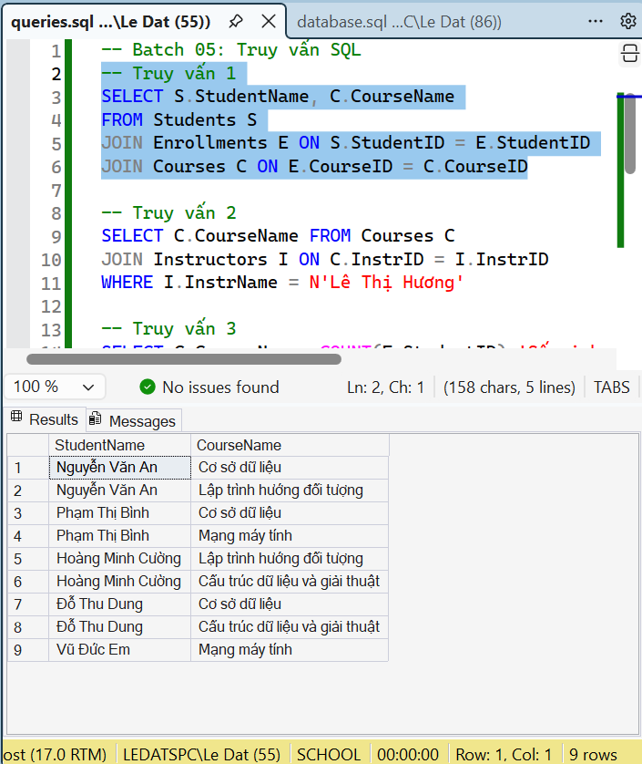

Week 01 - Database Design

Người nộp: Nguyễn Ngọc Huy

Mô tả thiết kế

Cơ sở dữ liệu quản lý đăng ký học phần gồm 4 bảng chính:
- Instructors: Lưu thông tin giảng viên (instructor_id, full_name, email, department).
- Students: Lưu thông tin sinh viên (uit_id, full_name, email, birth_date).
- Courses: Lưu thông tin môn học, phòng học và giảng viên phụ trách (course_id, course_name, room, instructor_id).
- Enrollments: Bảng trung gian lưu lịch sử đăng ký môn học của sinh viên (enrollment_id, student_id, course_id, enrollment_date).

Các mối quan hệ:
- Một giảng viên có thể phụ trách nhiều môn học (1-N).
- Một sinh viên có thể đăng ký nhiều môn học và ngược lại (N-N), được tách qua bảng trung gian Enrollments.

Các ràng buộc:
- Mỗi bảng đều có khóa chính (Primary Key) riêng biệt.
- Khóa ngoại (Foreign Key) liên kết chặt chẽ giữa các bảng để đảm bảo toàn vẹn dữ liệu.
- Sử dụng ràng buộc UNIQUE trên cặp (student_id, course_id) trong bảng Enrollments để tránh việc một sinh viên đăng ký trùng một môn học nhiều lần.

Cách chạy SQL

1. Mở công cụ MySQL Workbench (hoặc trình quản lý MySQL tương đương).
2. Chạy toàn bộ file database.sql theo thứ tự từ trên xuống để khởi tạo bảng và nạp dữ liệu mẫu.
3. Chạy file queries.sql để kiểm tra kết quả của 4 câu truy vấn theo yêu cầu.

4. Query Results

**1. Query 01: Liệt kê tên sinh viên và tên các môn đã đăng ký.**

**2. Query 02: Liệt kê các môn do 'GV02' cụ thể phụ trách.**

**3. Query 03: Đếm số sinh viên đăng ký từng môn, kể cả môn chưa có người đăng ký.**

**4. Query 04: Tìm sinh viên chưa đăng ký bất kỳ môn nào.**
