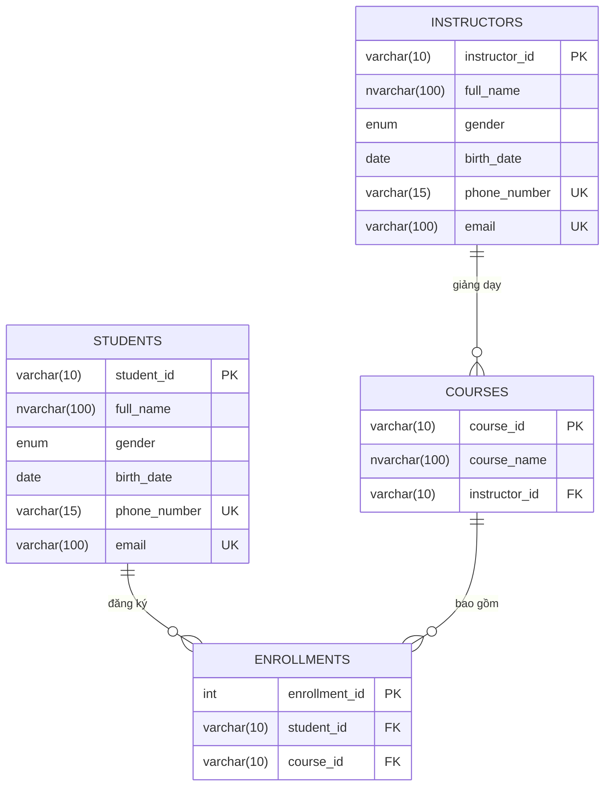

# Thông tin người nộp
**Họ và tên:** Trần Bảo Đăng
**MSSV:** 25520244

# Đặc tả Cơ sở dữ liệu

## 1. Sơ đồ quan hệ thực thể (ERD)



### Tổng quan mối quan hệ:

* **Giảng viên - Khóa học (`1 - N`)**: Một giảng viên (`instructors`) có thể phụ trách giảng dạy nhiều khóa học (`courses`), nhưng mỗi khóa học chỉ do một giảng viên chính đảm nhiệm.
* **Sinh viên - Khóa học (`N - N`)**: Một sinh viên (`students`) có thể đăng ký nhiều khóa học, và một khóa học có thể có nhiều sinh viên tham gia. Mối quan hệ này được phân rã thông qua bảng trung gian `enrollments`.

---

## 2. Chi tiết các bảng

### 2.1. Bảng `students` (Sinh viên)
Lưu trữ thông tin cá nhân và liên hệ của sinh viên.

| Tên cột | Kiểu dữ liệu | Ràng buộc | Mô tả |
| :--- | :--- | :--- | :--- |
| `student_id` | `VARCHAR(10)` | `PRIMARY KEY` | Mã định danh duy nhất của sinh viên. |
| `full_name` | `NVARCHAR(100)` | `NOT NULL` | Họ và tên đầy đủ của sinh viên (hỗ trợ Unicode). |
| `gender` | `ENUM('Male','Female')` | `NOT NULL` | Giới tính (`Male`: Nam, `Female`: Nữ). |
| `birth_date` | `DATE` | `NOT NULL` | Ngày tháng năm sinh (`YYYY-MM-DD`). |
| `phone_number` | `VARCHAR(15)` | `NOT NULL`, `UNIQUE` | Số điện thoại liên hệ (không được trùng lặp). |
| `email` | `VARCHAR(100)` | `NOT NULL`, `UNIQUE` | Địa chỉ email (không được trùng lặp). |

### 2.2. Bảng `instructors` (Giảng viên)
Lưu trữ thông tin cá nhân và liên hệ của đội ngũ giảng viên.

| Tên cột | Kiểu dữ liệu | Ràng buộc | Mô tả |
| :--- | :--- | :--- | :--- |
| `instructor_id` | `VARCHAR(10)` | `PRIMARY KEY` | Mã định danh duy nhất của giảng viên. |
| `full_name` | `NVARCHAR(100)` | `NOT NULL` | Họ và tên đầy đủ của giảng viên (hỗ trợ Unicode). |
| `gender` | `ENUM('Male','Female')` | `NOT NULL` | Giới tính (`Male`: Nam, `Female`: Nữ). |
| `birth_date` | `DATE` | `NOT NULL` | Ngày tháng năm sinh (`YYYY-MM-DD`). |
| `phone_number` | `VARCHAR(15)` | `NOT NULL`, `UNIQUE` | Số điện thoại liên hệ (không được trùng lặp). |
| `email` | `VARCHAR(100)` | `NOT NULL`, `UNIQUE` | Địa chỉ email (không được trùng lặp). |

### 2.3. Bảng `courses` (Khóa học / Môn học)
Lưu trữ danh sách các khóa học được mở và thông tin giảng viên phụ trách.

| Tên cột | Kiểu dữ liệu | Ràng buộc | Mô tả |
| :--- | :--- | :--- | :--- |
| `course_id` | `VARCHAR(10)` | `PRIMARY KEY` | Mã định danh duy nhất của khóa học. |
| `course_name` | `NVARCHAR(100)` | `NOT NULL` | Tên khóa học (hỗ trợ Unicode). |
| `instructor_id` | `VARCHAR(10)` | `NOT NULL`, `FOREIGN KEY` | Mã giảng viên phụ trách. Tham chiếu đến `instructors(instructor_id)`. |

### 2.4. Bảng `enrollments` (Đăng ký khóa học)
Lưu trữ lịch sử và trạng thái đăng ký khóa học của sinh viên.

| Tên cột | Kiểu dữ liệu | Ràng buộc | Mô tả |
| :--- | :--- | :--- | :--- |
| `enrollment_id` | `INT` | `PRIMARY KEY`, `AUTO_INCREMENT` | Mã giao dịch đăng ký tự động tăng. |
| `student_id` | `VARCHAR(10)` | `NOT NULL`, `FOREIGN KEY` | Mã sinh viên đăng ký. Tham chiếu đến `students(student_id)`. |
| `course_id` | `VARCHAR(10)` | `NOT NULL`, `FOREIGN KEY` | Mã khóa học được đăng ký. Tham chiếu đến `courses(course_id)`. |

* **Ràng buộc bổ sung:** `UNIQUE (student_id, course_id)` — Đảm bảo một sinh viên chỉ có thể đăng ký một khóa học tối đa **1 lần** (tránh trùng lặp dữ liệu đăng ký).

---

## 3. Cách chạy SQL

* Hệ quản trị cơ sở dữ liệu: **MySQL**
* **Thứ tự khởi tạo & nạp dữ liệu:** Cần tạo bảng và chèn dữ liệu theo đúng thứ tự phụ thuộc khóa ngoại để tránh lỗi ràng buộc:
  1. `students` và `instructors` (Không phụ thuộc bảng khác)
  2. `courses` (Phụ thuộc `instructors`)
  3. `enrollments` (Phụ thuộc `students` và `courses`)
* Các lệnh tạo bảng và chèn dữ liệu có trong `database.sql`
* Các truy vấn mẫu có trong `queries.sql`

---

## 4. Dữ liệu mẫu trong Cơ sở dữ liệu

### 4.1. Dữ liệu bảng `students` (5 bản ghi)

| `student_id` | `full_name` | `gender` | `birth_date` | `phone_number` | `email` |
| :--- | :--- | :--- | :--- | :--- | :--- |
| `25520244` | Trần Bảo Đăng | `Male` | `2007-09-21` | `0123456789` | `tranbaodang@gmail.com` |
| `25520302` | Võ Văn Đạt | `Male` | `2007-01-01` | `0987654321` | `vovandat@uit.edu.vn` |
| `24520123` | Võ Trần Ngọc Vy | `Female` | `2006-01-02` | `0546372819` | `voctrangocvy@gm.uit.edu.vn` |
| `26520001` | Nguyễn Gia Hưng | `Male` | `2008-07-15` | `0918273645` | `hungcubuso1vn@codeforces.com` |
| `25520211` | Phan Nguyễn Quốc Bảo | `Male` | `2007-12-01` | `0981273645` | `phannguyenquocbao@example.com` |

### 4.2. Dữ liệu bảng `instructors` (4 bản ghi)

| `instructor_id` | `full_name` | `gender` | `birth_date` | `phone_number` | `email` |
| :--- | :--- | :--- | :--- | :--- | :--- |
| `I001` | Lương Ngọc Hoàng | `Male` | `1990-09-21` | `0123456780` | `hoangnl@uit.edu.vn` |
| `I002` | Nguyễn Duy Khánh | `Male` | `1991-01-01` | `0987654320` | `khanhnd@uit.edu.vn` |
| `I003` | Nguyễn Thanh Sơn | `Male` | `1989-01-02` | `0546372810` | `sonnt@uit.edu.vn` |
| `I004` | Trần Hoàng Lộc | `Male` | `1988-07-15` | `0918273640` | `locth@uit.edu.vn` |

### 4.3. Dữ liệu bảng `courses` (5 bản ghi)

| `course_id` | `course_name` | `instructor_id` |
| :--- | :--- | :--- |
| `CS115` | Toán cho khoa học máy tính | `I001` |
| `IT002` | Lập trình hướng đối tượng | `I002` |
| `CS106` | Trí tuệ nhân tạo | `I003` |
| `IT003` | Cấu trúc dữ liệu và giải thuật | `I003` |
| `IT012` | Tổ chức và cấu trúc máy tính II | `I004` |

### 4.4. Dữ liệu bảng `enrollments` (8 bản ghi)

| `enrollment_id` | `student_id` | `course_id` |
| :--- | :--- | :--- |
| `1` | `25520244` | `CS115` |
| `2` | `25520244` | `IT002` |
| `3` | `25520302` | `CS106` |
| `4` | `25520302` | `IT003` |
| `5` | `24520123` | `IT003` |
| `6` | `26520001` | `CS115` |
| `7` | `26520001` | `IT002` |
| `8` | `26520001` | `CS106` |

# Query Results

**Query-01:** Liệt kê tên sinh viên và tên các môn đã đăng ký.
```
SELECT students.full_name, courses.course_name
FROM students NATURAL JOIN enrollments NATURAL JOIN courses;
```


**Query-02:** Liệt kê các môn do một giảng viên cụ thể phụ trách (trong ví dụ này là giảng viên Nguyễn Thanh Sơn)
```
SELECT instructors.full_name, courses.course_name
FROM instructors NATURAL JOIN courses
WHERE instructors.instructor_id = 'I003';
```


**Query-03:** Đếm số sinh viên đăng ký từng môn, kể cả môn chưa có người đăng ký.
```
SELECT courses.course_name, COUNT(enrollments.student_id) AS number_of_students
FROM courses LEFT JOIN enrollments ON courses.course_id = enrollments.course_id
GROUP BY courses.course_id;
```


**Query-04:** Tìm sinh viên chưa đăng ký bất kỳ môn nào.
```
SELECT students.full_name, COUNT(enrollments.course_id) AS number_of_courses
FROM students LEFT JOIN enrollments ON students.student_id = enrollments.student_id
GROUP BY students.student_id
HAVING number_of_courses = 0;
```

