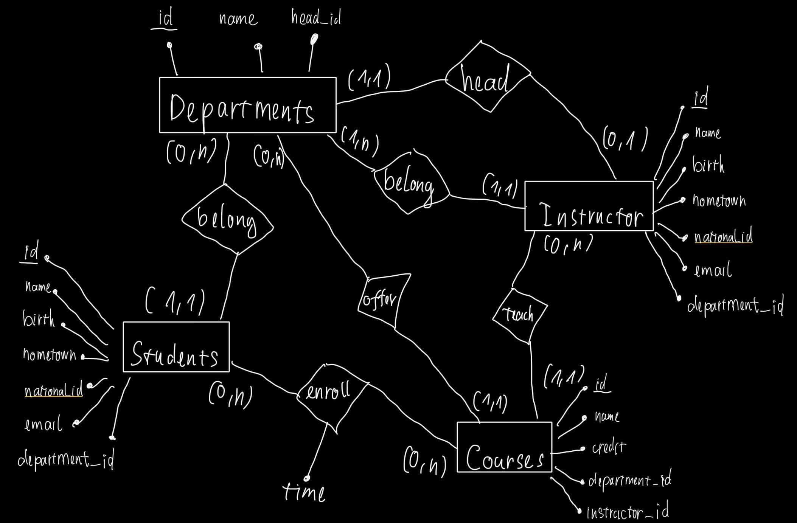
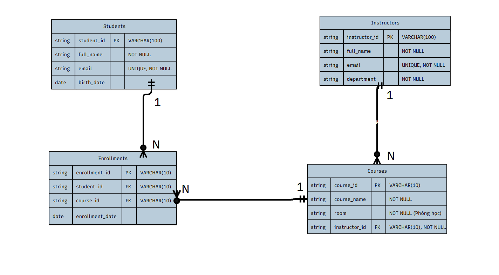
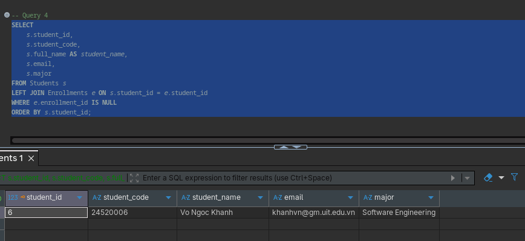
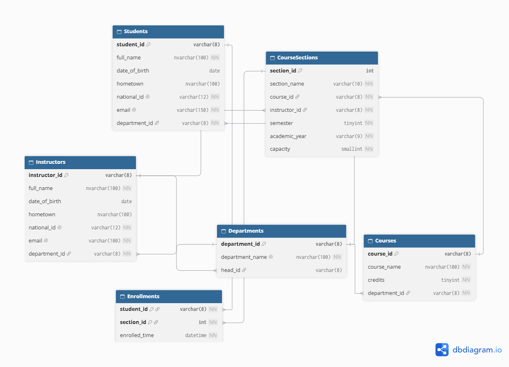

# Week 01 - Student Course Management

- Họ tên: Nguyễn Gia Toàn
- MSSV: `25521870`
- GitHub username: `nguyen-gia-toan`

## Mô tả database

Database `StudentCourse` lưu thông tin khoa, giảng viên, sinh viên, môn học và các môn sinh viên đã đăng ký. Gồm 5 bảng:

| Bảng | Khóa chính |
| --- | --- |
| `Departments` - Khoa | `department_id` |
| `Instructors` - Giảng viên | `instructor_id` |
| `Students` - Sinh viên | `student_id` |
| `Courses` - Môn học | `course_id` |
| `Enrollments` - Sinh viên đăng ký môn học | `(student_id, course_id)` |

## Mô hình thực thể - mối kết hợp

### Tân từ

- **Departments (Khoa):** mỗi khoa có mã khoa (khóa chính) và tên khoa (không trùng nhau). Một khoa có thể có một trưởng khoa là giảng viên của trường, hoặc chưa có trưởng khoa.
- **Instructors (Giảng viên):** mỗi giảng viên có mã giảng viên (khóa chính), họ tên, ngày sinh, quê quán, số CCCD (không trùng) và email (không trùng). Mỗi giảng viên thuộc đúng một khoa.
- **Students (Sinh viên):** mỗi sinh viên có mã sinh viên (khóa chính), họ tên, ngày sinh, quê quán, số CCCD (không trùng) và email (không trùng). Mỗi sinh viên thuộc đúng một khoa.
- **Courses (Môn học):** mỗi môn học có mã môn (khóa chính), tên môn và số tín chỉ (lớn hơn 0). Mỗi môn học do một khoa mở và do đúng một giảng viên phụ trách.
- **Đăng ký (enroll):** một sinh viên có thể đăng ký nhiều môn học hoặc chưa đăng ký môn nào. Một môn học có thể có nhiều sinh viên đăng ký hoặc chưa có ai đăng ký. Mỗi sinh viên chỉ được đăng ký một môn học một lần. Mỗi lượt đăng ký ghi nhận thời điểm đăng ký (`time`).

### Chuyển sang mô hình dữ liệu quan hệ

| Mối kết hợp | Cách chuyển |
| --- | --- |
| `head` | Cột `Departments.head_id` (khóa ngoại tới `Instructors`) |
| `belong` | Cột `Instructors.department_id` và `Students.department_id` (khóa ngoại tới `Departments`) |
| `offer` | Cột `Courses.department_id` (khóa ngoại tới `Departments`) |
| `teach` | Cột `Courses.instructor_id` (khóa ngoại tới `Instructors`) |
| `enroll` | Bảng trung gian `Enrollments(student_id, course_id, enrolled_at)`, khóa chính là 2 cột `(student_id, course_id)` |

## ERD dạng bảng

## Cách chạy SQL

1. Mở SSMS và kết nối đến SQL Server.
2. mở `database.sql`, bấm **Execute** để chạy toàn bộ file: tạo database `StudentCourse`, các bảng và dữ liệu mẫu.
3. Mở `queries.sql`. Bôi đen từng câu truy vấn rồi bấm **Execute** để chạy.

## Query Results

### Query 1: Tên sinh viên và các môn đã đăng ký

### Query 2: Các môn do một giảng viên cụ thể phụ trách

### Query 3: Số sinh viên đăng ký từng môn (kể cả môn chưa có người đăng ký)

### Query 4: Sinh viên chưa đăng ký môn nào

## Bonus: CourseSections

### Tân từ

- **CourseSections (Lớp học phần):** mỗi lớp học phần có mã định danh `section_id` (khóa chính), mã lớp `section_name` (ví dụ `Q11`), học kỳ `semester` (1, 2 hoặc 3), năm học `academic_year` (ví dụ `2026-2027`) và sĩ số tối đa `capacity` (lớn hơn 0). Mỗi lớp học phần thuộc đúng một môn học. Một môn học có thể mở nhiều lớp, ở nhiều học kỳ, hoặc chưa mở lớp nào. Không có hai lớp nào cùng môn, cùng mã lớp, cùng học kỳ và cùng năm học, mỗi lớp học phần do 1 giảng viên phụ trách.
- **Đăng ký (enroll):** sinh viên đăng ký lớp học phần. Một sinh viên có thể đăng ký nhiều lớp hoặc chưa đăng ký lớp nào. Một lớp có thể có nhiều sinh viên hoặc chưa có ai. Mỗi sinh viên chỉ đăng ký một lớp một lần, mỗi lượt đăng ký ghi nhận thời điểm đăng ký.
- **Giảng viên:** phụ trách lớp học phần (`CourseSections.instructor_id`).