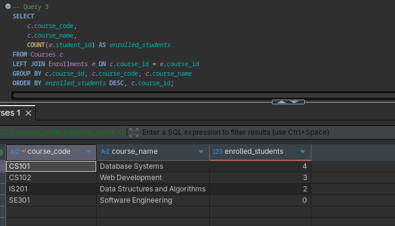

# Week 01 — Student Course Management Database

## Thông tin người nộp

- **Họ và tên:** Lê Phạm Tuấn Anh
- **GitHub:** `kan-ckm`
- **Email:** `at2356116@gmail.com`
- **Branch:** `le-pham-tuan-anh-solution`

## Mô tả thiết kế

Cơ sở dữ liệu `student_course_management` (MySQL 8.0+) gồm 4 bảng:

- **`Instructors`**: `instructor_id` (PK), `instructor_code` (UNIQUE), `full_name`, `email` (UNIQUE), `department`.
- **`Students`**: `student_id` (PK), `student_code` (UNIQUE), `full_name`, `email` (UNIQUE), `major`, `enrollment_year`.
- **`Courses`**: `course_id` (PK), `course_code` (UNIQUE), `course_name`, `credits`, `instructor_id` (FK -> `Instructors`).
- **`Enrollments`**: `enrollment_id` (PK), `student_id` (FK -> `Students`), `course_id` (FK -> `Courses`), `enrolled_at`.

### ERD


### Quan hệ và ràng buộc

- `Instructors` — `Courses` (1 - N): mỗi môn học thuộc về một giảng viên (`instructor_id NOT NULL`).
- `Students` — `Courses` (N - N): tách qua bảng trung gian `Enrollments` để chuẩn hóa (tránh lưu danh sách môn thành chuỗi trong `Students`), dễ kiểm tra khóa ngoại và thống kê bằng `JOIN` / `GROUP BY`.
- `UNIQUE (student_id, course_id)` trên `Enrollments` để ngăn sinh viên đăng ký trùng một môn.
- `CHECK (credits BETWEEN 1 AND 10)` trên `Courses` và `CHECK (enrollment_year BETWEEN 2000 AND 2100)` trên `Students`.

## Cách chạy SQL

> Yêu cầu **MySQL 8.0.13 trở lên** (do `Enrollments.enrolled_at` dùng `DEFAULT (CURRENT_DATE)`).

### Cách 1: Chạy bằng Docker + MySQL CLI

```bash
docker run -d \
  --name week01-mysql \
  -e MYSQL_ROOT_PASSWORD=root \
  -e MYSQL_DATABASE=student_course_management \
  -p 127.0.0.1:3306:3306 \
  mysql:8.4

docker exec -i week01-mysql mysql -uroot -proot < week01-database/database.sql
docker exec -i week01-mysql mysql -uroot -proot --table < week01-database/queries.sql
```

### Cách 2: Chạy bằng DBeaver hoặc MySQL Workbench

1. Kết nối tới MySQL Server (`127.0.0.1:3306`, database `student_course_management`). Nếu dùng DBeaver với MySQL 8+, bật `allowPublicKeyRetrieval=true` và `useSSL=false` trong **Driver properties**.
2. Mở file `database.sql` và chạy toàn bộ script từ đầu đến cuối (**`Alt + X`** trong DBeaver) để tạo bảng và thêm dữ liệu mẫu.
3. Mở file `queries.sql` và chạy từng câu truy vấn (**`Ctrl + Enter`** khi đặt con trỏ trong câu `SELECT`, hoặc **`Alt + X`** để chạy cả 4 câu).

## Phần nâng cao (Bonus)

- Thiết lập thêm `CHECK` constraint trên `Courses` (`CHECK (credits BETWEEN 1 AND 10)`) và `Students` (`CHECK (enrollment_year BETWEEN 2000 AND 2100)`) để đảm bảo tính hợp lệ của dữ liệu ngay ở tầng database.
- Giải thích chuẩn hóa: tách `Enrollments` giúp tránh lặp lại thông tin và tránh lưu danh sách đa trị trong bảng `Students` (đáp ứng 1NF–3NF cho mô hình 4 bảng cơ bản).

## Query Results

### Query 01 — Student Course List


### Query 02 — Instructor Courses


### Query 03 — Enrollment Count


### Query 04 — Students Without Enrollments

